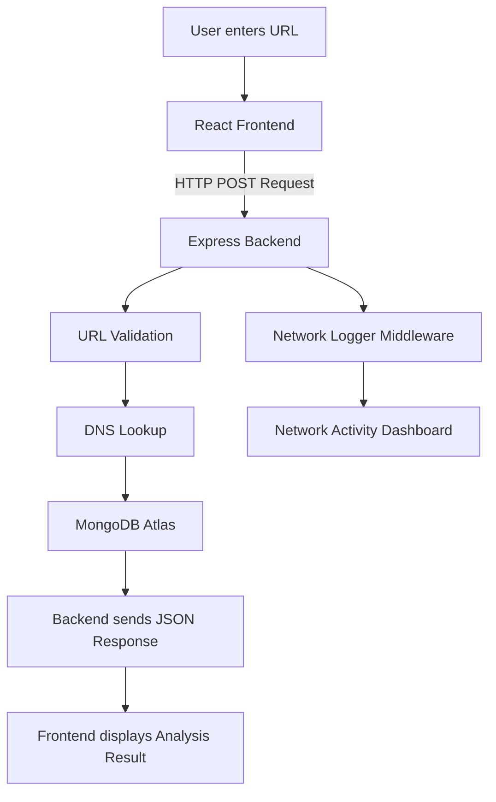

# URL Shield – Network Communication Flow



## Description

1. The user enters a URL in the React application.
2. React sends an HTTP POST request to the Express backend.
3. The backend validates the URL.
4. The DNS service retrieves the domain's IP addresses.
5. The URL analysis and DNS information are stored in MongoDB Atlas.
6. The backend returns the analysis result as a JSON response.
7. React displays the result to the user.
8. The network logger records HTTP request information for the Network Activity dashboard.
```
