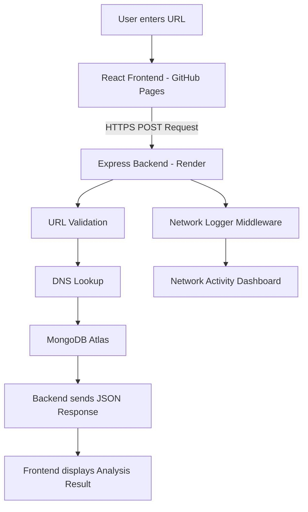

# URL Shield – Network Communication Flow

## 1. Network Flow Diagram



## 2. Description

1. The user enters a URL in the React application.
2. React sends an HTTPS POST request to the Express backend.
3. The backend validates the submitted URL.
4. The DNS service attempts to retrieve the domain's IP addresses when applicable.
5. The URL analysis result and DNS information are stored in MongoDB Atlas.
6. The backend returns the analysis result as a JSON response.
7. React displays the result to the user.
8. The network logger middleware records HTTP request information for the Network Activity dashboard.

## 3. Conclusion

The network communication flow explains how the client, frontend, backend and database communicate in the URL Shield application using HTTPS requests, DNS lookup and JSON responses.
```
