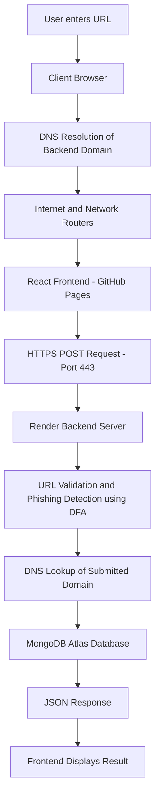

# Packet Flow – URL Shield

## 1. Introduction

Packet flow explains how data travels from the client to the server and how the response returns to the client.

URL Shield uses HTTPS communication between the React frontend and Node.js backend.

## 2. Packet Flow Diagram



## 3. Request Flow

1. The user enters a URL in the browser.
2. The browser loads the React frontend hosted on GitHub Pages.
3. DNS resolves the frontend and backend domain names into IP addresses when required.
4. The frontend sends an HTTPS POST request to the Render backend.
5. The request travels through the Internet using network routers.
6. The Render service forwards the request to the Node.js and Express application.
7. The backend validates the submitted URL using DFA and validation rules.
8. The backend performs DNS lookup to obtain the submitted domain's IP addresses when applicable.
9. The analysis result and DNS information are stored in MongoDB Atlas.

## 4. Response Flow

1. MongoDB Atlas responds to the backend after the database operation.
2. The backend prepares a JSON response containing the URL status, detection reasons, URL details and DNS information.
3. The response travels back through the established HTTPS connection.
4. The React frontend receives the JSON response.
5. The frontend displays the analysis result to the user.

## 5. Protocols and Ports

| Protocol | Port | Purpose |
|---|---|---|
| HTTPS | 443 | Secure communication between browser and deployed backend |
| DNS | 53 | Domain name resolution |
| MongoDB | 27017 | Default MongoDB connection port, subject to Atlas connection configuration |

The Render backend uses an internal application port of 10000 in this deployment. The external client accesses the service through HTTPS on port 443.

## 6. Network Communication

The application follows a client-server communication model. The frontend sends an HTTPS request, and the backend returns a JSON response.

Network routers forward data between networks. TCP provides reliable transport for HTTPS connections when HTTP/1.1 or HTTP/2 is used.

The backend communicates separately with MongoDB Atlas to store and retrieve URL analysis records.

## 7. Conclusion

Packet flow in URL Shield demonstrates how a client request travels through the Internet to the backend server, how URL validation and database operations are performed, and how the analysis response returns to the frontend.
```
