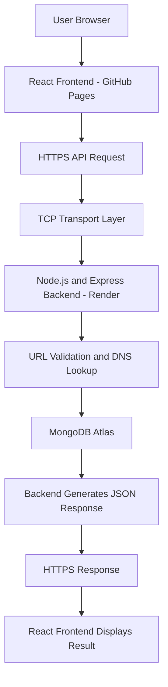

# Transmission Control Protocol (TCP) – URL Shield

## 1. Introduction

TCP stands for Transmission Control Protocol. It is a connection-oriented transport layer protocol that provides reliable communication between devices over a network.

TCP ensures that data is delivered accurately, completely and in the correct order.

URL Shield uses HTTPS communication between the client browser and the Node.js backend. When HTTP/1.1 or HTTP/2 is used, TCP provides reliable data transmission.

## 2. Features of TCP

TCP provides the following features:

- Connection-oriented communication.
- Reliable data transmission.
- Error detection and retransmission.
- Ordered delivery of data.
- Flow control.
- Congestion control.

## 3. TCP Three-Way Handshake

TCP establishes a connection between the client and server using a three-way handshake.

1. SYN: The client sends a connection request to the server.
2. SYN-ACK: The server acknowledges the client's request.
3. ACK: The client confirms the server's response.

After these three steps, the TCP connection is established and data transmission can begin.

## 4. TCP Communication in URL Shield

1. The user opens the URL Shield application in a web browser.
2. The browser accesses the React frontend hosted on GitHub Pages.
3. The frontend sends an HTTPS API request to the Node.js and Express backend hosted on Render.
4. When HTTP/1.1 or HTTP/2 is used, TCP provides reliable data transmission.
5. The backend validates the submitted URL and performs DNS lookup when applicable.
6. The backend stores the analysis result in MongoDB Atlas.
7. The backend sends a JSON response to the frontend.
8. The frontend displays the analysis result to the user.

## 5. TCP Port Number

Port 443 is the standard port used for HTTPS communication between the browser and deployed services.

During local development, port 5000 is used by the backend server.

In our Render deployment, port 10000 is used as the internal backend application port.

## 6. TCP Communication Flow Diagram

The following diagram represents the communication flow between the client browser and the backend server in URL Shield.

## 7. TCP Data Transmission

TCP provides reliable data transmission through the following mechanisms:

- Segmentation: Divides application data into smaller segments.
- Sequencing: Maintains the correct order of transmitted data.
- Acknowledgement: Confirms successful receipt of data.
- Retransmission: Resends lost data when required.
- Flow Control: Prevents the sender from overwhelming the receiver.
- Congestion Control: Helps reduce network congestion.

## 8. TCP and URL Shield Architecture

The URL Shield application uses HTTPS for secure communication between the browser and backend server.

When HTTP/1.1 or HTTP/2 is used, TCP works at the transport layer and supports reliable request and response delivery.

TCP communication is handled by the browser, operating system and hosting infrastructure. The application does not implement TCP directly.

Note: HTTP/3 uses QUIC over UDP instead of TCP.

## 9. Conclusion

TCP is an important transport layer protocol that provides reliable and ordered data transmission.

In URL Shield, TCP supports HTTPS-based communication between the client browser and backend server when HTTP/1.1 or HTTP/2 is used. It helps transfer API requests and responses reliably.
