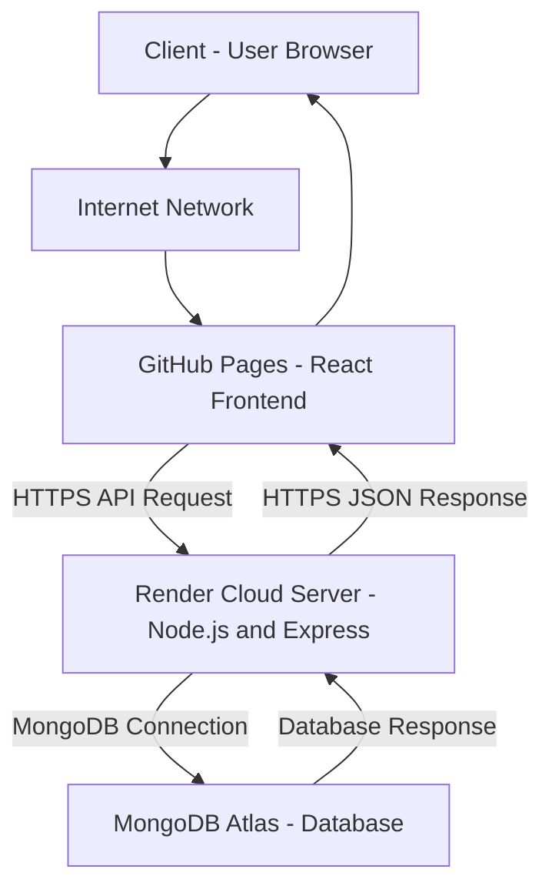

# Network Topology – URL Shield

## 1. Introduction

URL Shield follows a client-server network architecture. It connects the user browser, React frontend, Node.js backend and MongoDB Atlas database through the Internet.

## 2. Network Topology Diagram

## 3. Components Used

### Client
The client is the user's web browser. The user enters a URL into the URL Shield application.

### Frontend
The React frontend is hosted on GitHub Pages. It accepts user input and displays URL analysis results.

### Internet Network
The Internet connects the client browser, frontend hosting service and backend server. Routers and gateways forward network traffic between networks.

### Backend Server
The Node.js and Express backend is hosted on Render. It validates URLs, performs DNS lookup and communicates with MongoDB Atlas.

### Database Server
MongoDB Atlas stores URL analysis history, detection reasons, URL details and DNS lookup information.

## 4. Communication Between Components

1. The user enters a URL in the browser.
2. The browser loads the React frontend from GitHub Pages.
3. The frontend sends an HTTPS API request to the Render backend.
4. The backend validates the submitted URL.
5. The backend performs DNS lookup when applicable.
6. The analysis result is stored in MongoDB Atlas.
7. The backend sends a JSON response to the frontend.
8. The frontend displays the analysis result to the user.

## 5. Network Architecture

The application uses a client-server architecture with a cloud-hosted frontend, backend and database.

HTTPS is used for communication between the browser, frontend hosting service and backend API. MongoDB Atlas uses a separate database connection from the backend.

## 6. Conclusion

The network topology of URL Shield demonstrates how a client browser communicates with a web frontend, backend server and cloud database through the Internet. This architecture enables URL validation, phishing detection and result storage.
